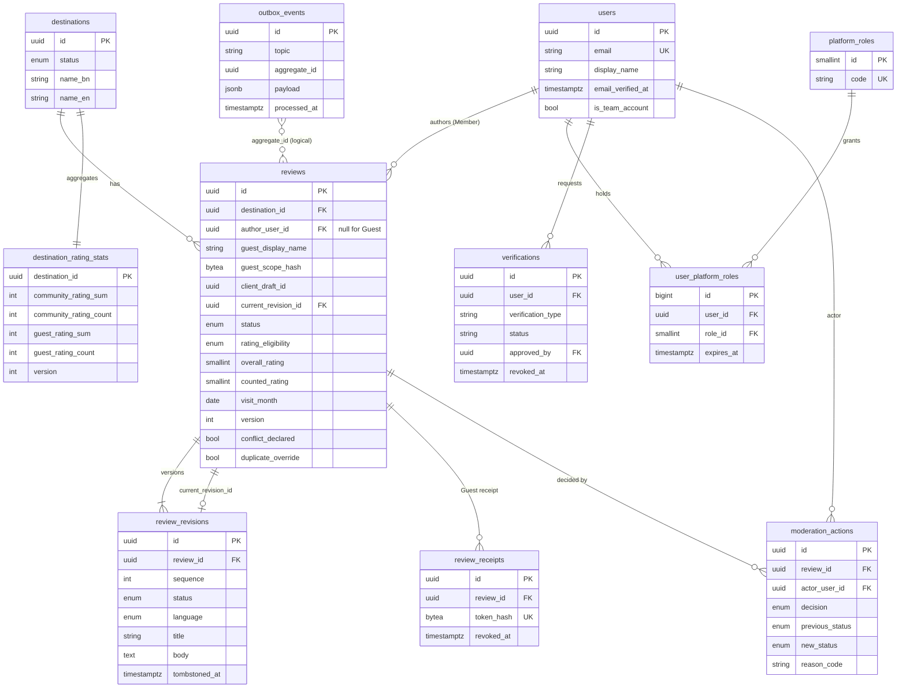

# Abhijatri Database Schema (ERD)

**Status:** Draft for F02 review, 15 October 2026. Source of truth for implemented tables is `backend/app/models.py` and `backend/migrations/`; planned tables come from `Features/Review.md` section 9.1 and the Gantt tasks named below. A test (`backend/tests/test_docs_schema.py`) fails if an implemented table is missing from this file.

Database: PostgreSQL 17 (Supabase-managed in shared environments). Schema changes go through Alembic only.

## 1. Entity-relationship diagram

## 2. Implemented tables

| Table | Purpose | Key constraints and indexes | Privacy class |
|---|---|---|---|
| `destinations` | Bilingual destination identity and publication state. | PK `id`; enum `destination_status`. | Public |
| `users` | Account identity. | Unique `email`. | Personal data |
| `platform_roles` | Staff role catalogue (`MODERATOR`, `ADMINISTRATOR`, `SUPER_ADMINISTRATOR`). | Unique `code`. | Internal |
| `user_platform_roles` | Role assignment with optional expiry. | Unique `(user_id, role_id)`. | Internal |
| `verifications` | Verified Member state; separate from staff authority. | FK to `users` (subject and approver). | Sensitive |
| `reviews` | Stable review identity, state machine, counted rating, optimistic `version`. | `ck_review_rating_range` (1-5); `ck_review_counted_rating_range`; `ck_review_author_shape` (Member xor Guest); `uq_reviews_guest_draft` and `uq_reviews_member_draft` (permanent draft uniqueness); `uq_reviews_member_active_visit` (one active review per Member, destination, month unless override); `ix_reviews_published_feed` (partial, `status = 'PUBLISHED'`). | Public when `PUBLISHED`, otherwise private |
| `review_revisions` | Append-only submitted versions; body tombstoned only by retention. | Unique `(review_id, sequence)`; `ck_revision_rating_range`. | Private until published |
| `review_receipts` | Hashed Guest receipt (HMAC-SHA-256 with pepper); never the raw token. | Unique `token_hash`; `revoked_at`. | Secret-derived |
| `destination_rating_stats` | O(1) Community and Guest sum/count aggregates, updated under row lock. | Non-negative `CHECK`s; `version`. | Public aggregate |
| `moderation_actions` | Append-only record of each moderation transition. | FK `RESTRICT` to review and actor. | Internal audit |
| `outbox_events` | Transactional follow-up events (cache, search, media). | `processed_at` null means pending. | Internal |

Enums: `destination_status`, `review_status`, `rating_eligibility`, `revision_status`, `review_language`, `traveller_type`, `comfort_tier`, `moderation_decision`, `moderation_previous_status`, `moderation_new_status`.

## 3. Planned tables (not yet migrated)

| Table | Needed by | Notes |
|---|---|---|
| `auth_identities` | R04 | Password hash (Argon2id), email-verification and reset token digests with expiry. |
| `user_sessions` | R04 | Server-side session id digest, created/expires/revoked, separate staff and member scopes. |
| `review_category_ratings` | R07 | Per-category scores for a revision. |
| `review_reports`, `moderation_cases` | R11 | Duplicate-open-report control; queue priority and escalation. |
| `audit_events` | R11, Security 4.4 | Append-only privileged activity; `UPDATE`/`DELETE` revoked from the app role. `moderation_actions` may be folded in. |
| `idempotency_keys` | R16 | Unique `(scope, key)`, request hash, stored response, expiry. |
| `destination_advisories`, `destination_contacts` | R02 | Source, date, licence, language, `expires_at`; expired items never shown as current. |
| `destination_pack_versions` | R14 | Pack version, generated date, content hash, manifest. |
| `review_media` | Post-core | Only if the media pipeline starts (Review.md section 8). |
| `price_catalogue_items`, `estimates`, `saved_trip_briefs` | M2 (E06-E09) | Out of scope until M1. |

## 4. Rules that apply to every table

- UUID primary keys for public identifiers; UTC `timestamptz` columns.
- Foreign keys use `RESTRICT` for audit data and `CASCADE` only for owned child rows.
- No raw NID, no exact location, no advertising identifiers (Security.md).
- Rating changes go only through the locked delta path in `app/services.py`.
