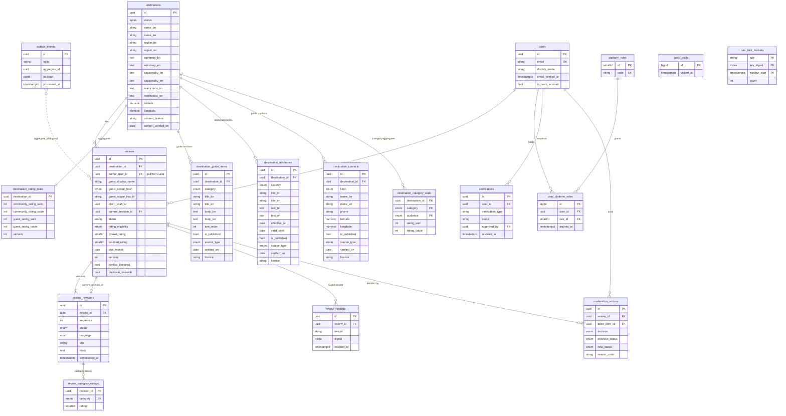

# Abhijatri Database Schema (ERD)

**Status:** Draft for F02 review, 15 October 2026; destination content tables added for R02 on 19 October 2026. Source of truth for implemented tables is `backend/app/models.py` and `backend/migrations/`; planned tables come from `Features/Review.md` section 9.1 and the Gantt tasks named below. A test (`backend/tests/test_docs_schema.py`) fails if an implemented table is missing from this file.

Database: PostgreSQL 17 (Supabase-managed in shared environments). Schema changes go through Alembic only.

## 1. Entity-relationship diagram

## 2. Implemented tables

| Table | Purpose | Key constraints and indexes | Privacy class |
|---|---|---|---|
| `destinations` | Bilingual destination identity, publication state and profile text (region, summary, seasonality, restrictions, coordinates, content licence). Profile columns are nullable until R01 content is entered. | PK `id`; enum `destination_status`; `ck_destination_latitude_range`, `ck_destination_longitude_range`, `ck_destination_coordinates_pair`; partial index `ix_destinations_published_name`. | Public when `PUBLISHED` |
| `users` | Account identity. | Unique `email`. | Personal data |
| `platform_roles` | Staff role catalogue (`MODERATOR`, `ADMINISTRATOR`, `SUPER_ADMINISTRATOR`). | Unique `code`. | Internal |
| `user_platform_roles` | Role assignment with optional expiry. | Unique `(user_id, role_id)`. | Internal |
| `verifications` | Verified Member state; separate from staff authority. | FK to `users` (subject and approver). | Sensitive |
| `reviews` | Stable review identity, state machine, counted rating, optimistic `version`. | `ck_review_rating_range` (1-5); `ck_review_counted_rating_range`; `ck_review_author_shape` (Member xor Guest); `uq_reviews_guest_draft` and `uq_reviews_member_draft` (permanent draft uniqueness); `uq_reviews_member_active_visit` (one active review per Member, destination, month unless override); `ix_reviews_published_feed` (partial, `status = 'PUBLISHED'`). | Public when `PUBLISHED`, otherwise private |
| `review_revisions` | Append-only submitted versions; body tombstoned only by retention. | Unique `(review_id, sequence)`; `ck_revision_rating_range`. | Private until published |
| `review_receipts` | Keyed digest of the client-generated Guest receipt (HMAC-SHA-256, label `abhijatri:review-receipt:v1`, versioned key); never the raw receipt. | `key_id`, `digest`; unique `uq_review_receipt_key_digest (key_id, digest)`; `revoked_at`. Rows from the old server-issued scheme are revoked and marked `legacy`. | Secret-derived |
| `destination_rating_stats` | O(1) Community and Guest sum/count aggregates, updated under row lock. | Non-negative `CHECK`s; `version`. | Public aggregate |
| `review_category_ratings` | Optional per-category score (1 to 5) for a revision; one row per rated `review_category`, absent when not applicable (Review.md 3.1, amendment A2). Migration `0006`. | Composite PK `(revision_id, category)`; FK `revision_id` `CASCADE`; `ck_category_rating_range`. | Private until published |
| `destination_category_stats` | O(1) per-category sum/count for each destination and audience (`GUEST` or `COMMUNITY`), moved in the same transaction and lock order as `destination_rating_stats`. Migration `0006`. | Composite PK `(destination_id, category, audience)`; FK `CASCADE`; `ck_category_stats_sum_nonnegative`, `ck_category_stats_count_nonnegative`. | Public aggregate |
| `guest_visits` | Guest footprint: one row per guest per Asia/Dhaka day, holding **only** a running number (`id`) and `visited_at`. It answers "how many guests came each day", never "who". **No other guest data is stored anywhere**: no name, device id, hash, address or user reference (scope owner, 20 Oct 2026). Migration `0008` replaced the `0007` per-device digest table. | PK `id` (identity); index `ix_guest_visits_visited_at`. | Aggregate count, no identifiers |
| `destination_guide_items` | Bilingual attraction, accommodation, food, transport and local-practice entries with provenance. | FK `destination_id` `CASCADE`; enum `guide_category`; index `ix_guide_items_destination_category`; shown only when `is_published`. | Public when published |
| `destination_advisories` | Dated bilingual advisories: `effective_on`, `valid_until` (Asia/Dhaka dates), `verified_on`, source and licence. | FK `CASCADE`; enum `advisory_severity`; `ck_advisory_validity_window` (`valid_until >= effective_on`); index `ix_advisories_destination_valid_until`. State (`CURRENT`, `STALE`, `EXPIRED`, `NOT_YET_EFFECTIVE`) is derived at read time, never stored. | Public when published |
| `destination_contacts` | Public institution and emergency contacts with coordinates and provenance. No personal contacts. | FK `CASCADE`; enum `contact_kind`; `ck_contact_phone_format`, `ck_contact_latitude_range`, `ck_contact_longitude_range`, `ck_contact_coordinates_pair`; index `ix_contacts_destination_kind`. | Public when published |
| `rate_limit_buckets` | Durable fixed-window attempt counters for Guest submission and receipt operations, keyed by a keyed digest of the Guest scope, receipt or network address. Each increment commits in its own transaction; windows older than two days are purged. | Composite PK `(rule, key_digest, window_start)`; `ck_rate_limit_count_nonnegative`; index on `window_start`. | Internal, no raw identifiers |
| `moderation_actions` | Append-only record of each moderation transition. | FK `RESTRICT` to review and actor. | Internal audit |
| `outbox_events` | Transactional follow-up events (cache, search, media). | `processed_at` null means pending. | Internal |

Enums: `destination_status`, `source_type`, `guide_category`, `advisory_severity`, `contact_kind`, `review_status`, `rating_eligibility`, `revision_status`, `review_language`, `traveller_type`, `comfort_tier`, `moderation_decision`, `moderation_previous_status`, `moderation_new_status`, `review_category`, `rating_audience`.

## 3. Planned tables (not yet migrated)

| Table | Needed by | Notes |
|---|---|---|
| `auth_identities` | R04 | Password hash (Argon2id), email-verification and reset token digests with expiry. |
| `user_sessions` | R04 | Server-side session id digest, created/expires/revoked, separate staff and member scopes. |
| `review_reports`, `moderation_cases` | R11 | Duplicate-open-report control; queue priority and escalation. |
| `audit_events` | R11, Security 4.4 | Append-only privileged activity; `UPDATE`/`DELETE` revoked from the app role. `moderation_actions` may be folded in. |
| `idempotency_keys` | R16 | Unique `(scope, key)`, request hash, stored response, expiry. |
| `destination_pack_versions` | R14 | Pack version, generated date, content hash, manifest. |
| `review_media` | Core (Review.md amendment A1) | Verified Member images: object key, title, alt text, caption, type, dimensions, processed size, ownership declaration, revision, moderation and removal state (Review.md section 8). |
| `price_catalogue_items`, `estimates`, `saved_trip_briefs` | M2 (E06-E09) | Out of scope until M1. |

## 4. Rules that apply to every table

- UUID primary keys for public identifiers; UTC `timestamptz` columns.
- Foreign keys use `RESTRICT` for audit data and `CASCADE` only for owned child rows.
- No raw NID, no exact location, no advertising identifiers (Security.md).
- Rating changes go only through the locked delta path in `app/services.py`.
- Row-level security is enabled on every table in `public` by migration `0002_enable_rls` (no policies), and `anon`/`authenticated` grants are revoked when those Supabase roles exist. The backend connects as the table owner, which bypasses RLS. `tests/test_rls.py` enforces this.
- Maintained destination content (`destination_guide_items`, `destination_advisories`, `destination_contacts`) carries the Platform Foundation 17 provenance columns: `source_type`, `source_ref`, `publisher`, `effective_on`, `verified_on`, `next_review_on`, `licence`, `researcher`, `reviewer`. `researcher` and `reviewer` are internal and never returned by the public API.
- Advisory validity and staleness are calendar rules evaluated on the `Asia/Dhaka` date (`DEFAULT_DISPLAY_TIMEZONE`), not the UTC date.
